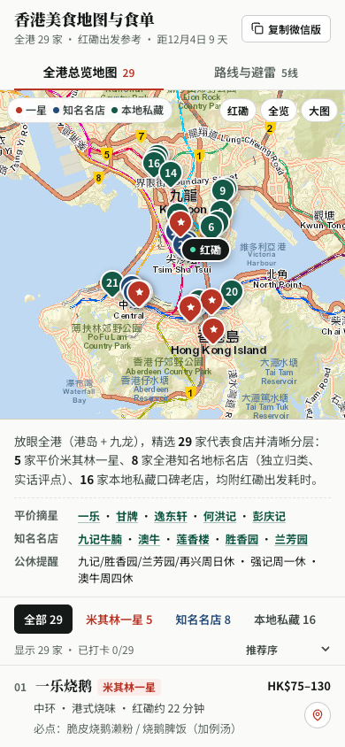

# Hong Kong Food Map & Guide / 香港美食地图与真口碑食单

中文：面向手机浏览的香港本地美食地图与攻略，覆盖全港 29 家精选食店，清晰划分为「平价米其林一星（5家）」「全港知名名店（8家，如九记牛腩、澳洲牛奶公司、莲香楼等）」「本地私藏口碑（16家）」。内置红磡出发耗时参考、Esri 中文实景交互地图（免 API Key）、5 条顺路觅食路线、网红避雷平替与一键复制微信食单。

English: A mobile-first Hong Kong food map and curated dining guide featuring 29 vetted spots across Hong Kong Island and Kowloon—organized into affordable 1-Michelin-star eateries (5), iconic Hong Kong classics (8), and local favorites (16). Includes a live bilingual Esri street map with MTR lines, transit times from Hung Hom, 5 curated itineraries, anti-hype comparisons, and one-tap Google/Amap navigation.



## 在线体验 / Live Demo

- [Cloudflare Demo](https://hk-food-guide.xiaosang.cc/)
- [GitHub Repo](https://github.com/holynova/hk-food-guide)


## 本地运行 / Run locally

```bash
npm run dev
```

也可直接在浏览器打开 `index.html`。

## 发布 / Deploy

```bash
npm run deploy:check
npm run deploy
```

Cloudflare Workers · Custom Domain: `hk-food-guide.xiaosang.cc`

源码与部署配置使用同一个 `main` 分支；在本地手动发布，不创建 Cloudflare 专用分支或 GitHub Action。
